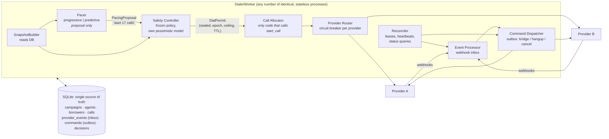

# Architecture

## The pipeline



Plain-text version:

```
Campaign ─► Pacer ─► Safety Controller ─► Call Allocator ─► Provider Router ─► Provider A / B
 (DB row)   (proposal)  (DialPermit)       (start_call)      (health)              │
                                                                                   │ webhooks
   Reconciler ─► Event Processor (inbox) ─► Command Dispatcher (outbox) ◄──────────┘
        └──────────────── every arrow reads/writes one SQLite database ────────────────┘
```

Every worker runs the same loop (`worker.py`): reconcile, then for each campaign it leads,
snapshot → propose → decide → shed/allocate. Webhooks can arrive at any worker.

## Components

| Module | Responsibility | Can it place a call? |
|---|---|---|
| `pacing/progressive.py`, `pacing/predictive.py` | Pure function: `PacingSnapshot → PacingProposal` with a written explanation | No. The `pacing` package imports nothing from the DB, allocator or providers (enforced by `test_pacing_cannot_reach_providers_allocator_or_database`) |
| `safety.py` | Recomputes risk with its own pessimistic assumptions; approves, reduces, rejects, falls back to progressive, or sheds; mints a `DialPermit` | No, it only authorises |
| `allocator.py` | Atomically reserves agent + borrower + inserts the call, then calls `start_call` outside the transaction | Yes, and only with a valid permit from the current leadership epoch |
| `events.py` | Webhook inbox: dedupe by `(provider, event_id)`, apply forward-only in one transaction | No |
| `commands.py` | Outbox: sends BRIDGE / HANGUP / CANCEL that a transaction decided on, retries with backoff | Only cancel/hangup/bridge existing calls |
| `recovery.py` | Expired leases, lost heartbeats, stuck calls (asks the provider), pending events and commands | No new calls |
| `agents.py` | Agent desktop operations; what happens when an agent disappears | No |
| `providers/` | `TelecomProvider` interface, circuit breaker + router, mock providers A and B, a scripted provider for tests | n/a |
| `db.py`, `repo.py` | Schema; compare-and-set helpers every state change goes through | n/a |
| `invariants.py` | Cross-table checks run by tests, the simulator and the load test | n/a |

## Data model

| Table | Key columns | Notes |
|---|---|---|
| `campaigns` | `mode`, `leader`, `leader_until`, `epoch` | Pacing leadership lease; `epoch` is the fencing token |
| `agents` | `state`, `call_id`, `state_since`, `heartbeat_at`, `version` | `state_since` orders "longest idle first" |
| `borrowers` | `status`, `priority`, `attempts`, `provider_failures`, `next_attempt_at`, `call_id` | Borrower-caused and provider-caused failures are counted separately |
| `calls` | `id` (also the provider idempotency key), `kind` BOUND/SPECULATIVE, `state`, `agent_id`, `owner`, `lease_until`, timestamps, `cancel_requested_at` | Partial unique indexes: one live call per agent, one live call per borrower |
| `provider_events` | PK `(provider, event_id)`, `status`, `outcome`, `lease_until` | Inbox and dedupe in one |
| `commands` | `UNIQUE(call_id, kind)`, `status`, `attempts`, `next_attempt_at` | Outbox; enqueueing is idempotent |
| `decisions` | proposed vs approved, action, full explanation text | Answers "why did it dial 17 calls at 10:42:13?" after the fact |

## Two workers see the same AVAILABLE agent at the same time

Reservation is one statement inside a `BEGIN IMMEDIATE` transaction:

```sql
UPDATE agents SET state='RESERVED', call_id=:call, version=version+1
WHERE id = (SELECT id FROM agents
            WHERE campaign_id=:c AND state='AVAILABLE' AND heartbeat_at >= :fresh
            ORDER BY state_since LIMIT 1)
  AND state='AVAILABLE'                       -- the compare-and-set
RETURNING id
```

* SQLite has one writer at a time. `BEGIN IMMEDIATE` takes the write lock before reading, so
  worker 2 waits (`busy_timeout`) until worker 1 commits. Worker 2 then sees the agent as
  RESERVED and either picks the next agent or gets no row back.
* The `AND state='AVAILABLE'` guard makes the same code correct on a database where two
  transactions *can* overlap. In PostgreSQL at READ COMMITTED, the second UPDATE blocks on the
  row lock, re-checks its WHERE clause after the first commits, and matches nothing. At scale it
  would become `SELECT ... FOR UPDATE SKIP LOCKED`, so workers skip the contested row instead of
  queueing on it.
* The backstop is in the data: `one_live_call_per_agent` is a partial unique index. Even a buggy
  code path cannot create a second live call for an agent; the insert fails and the allocator
  counts an `integrity_conflict`.

This is demonstrated with 20 threads and with 4 separate OS processes on a shared database
(`tests/test_concurrency.py`, `python -m sim.failures race`).

**"The database says AVAILABLE but the cache says RESERVED. Which wins?"** There is no cache. The
database is the only source of truth, and every decision that changes state is a
compare-and-set against it. If a cache were added later (for dashboards, say), it would be
advisory only. Nothing would reserve, dial or release based on it.

## Distributed-systems concerns

| Concern | How it is handled |
|---|---|
| Agent allocation | CAS on `state` + partial unique index (above). Only agents with a fresh heartbeat are eligible |
| Borrower allocation | Same CAS shape on `borrowers.status`; `one_live_call_per_borrower` unique index; priority then due time |
| Duplicate jobs | One pacing leader per campaign (lease). Ceilings are *absolute levels* checked inside the insert transaction ("at most N agentless calls in flight"), not deltas, so two permits computed from the same snapshot cannot add up to double the risk (`test_two_allocators_cannot_jointly_exceed_the_agentless_ceiling`) |
| Stale leader (GC pause, partition) | Leadership has an epoch that increments on every change of hands. The allocator checks the permit's epoch in the same transaction that reserves; an old leader's permit is refused (`test_stale_pacing_leader_is_fenced_off`). Permits also expire after 2s |
| Retries | `start_call` is idempotent on our call id. A retried attempt for a borrower is a *new* call row (new id) created only after the previous one is terminal. Outbox commands retry with backoff; provider operations are idempotent |
| Idempotency | Webhooks: PK dedupe + forward-only rank rule. Commands: `UNIQUE(call_id, kind)`. Reconciler replays provider status as events with deterministic ids |
| Concurrent updates | Every write is CAS on the expected state (and, for agents, the expected `call_id`, so a late event for an old call cannot move an agent who has moved on) |
| Worker crashes | Nothing important lives in memory. A call row carries a lease (`owner`, `lease_until`) until the provider's acceptance is recorded; webhooks are persisted before being applied; side effects sit in the outbox. Any worker's reconciler picks up whatever an expired lease left behind. See [FAILURE_SCENARIOS.md](FAILURE_SCENARIOS.md) |
| Stale state | The snapshot ignores agents with a stale heartbeat even before the reconciler logs them out. Unanswered calls older than the longest possible ring stop counting as risk. A new pacing leader starts with a 10s warm-up and empty history, so it behaves conservatively |
| Provider events | Inbox, dedupe, forward-only application, terminal states absorb everything, and facts (such as `answered_at`) are kept even from stale events |

## Why one database and no queue

Every hard question in this assignment ("can two workers take this agent?", "did this event
already happen?", "who owns this half-finished call?") is a question about *shared state
transitions*. A relational database with transactions answers all of them in one place: CAS
updates, unique indexes, an inbox table and an outbox table. Adding Redis or Kafka would add a
second source of truth and the consistency problems between the two, without removing any of
those questions. The trade-offs, and where this stops scaling, are in [DECISIONS.md](DECISIONS.md)
and [SCALING.md](SCALING.md).

## Time

All components read time through a `Clock`. The simulator (`sim/engine.py`) runs the real worker
code against mock providers on a simulated clock, so an hour of dialing for 50 agents takes about
4 seconds and is reproducible from a seed. The load test runs the same code on the wall clock in
separate OS processes.
