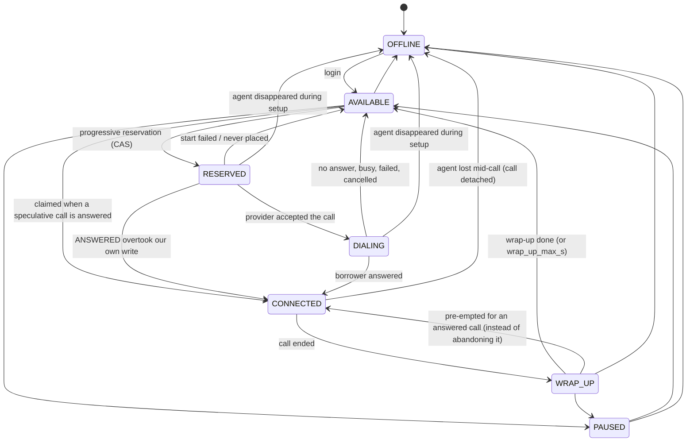
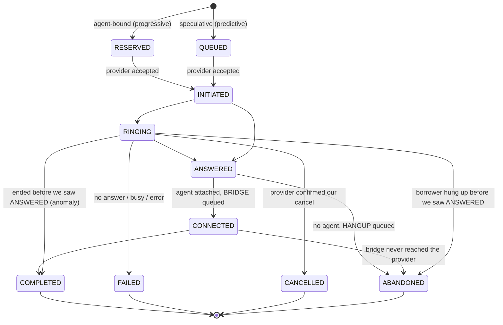

# State machines

The legal transitions are defined once, in [`smartdialer/states.py`](../smartdialer/states.py).
Every state write goes through `repo.move_agent` / `repo.move_call`, which (1) checks the
transition against those tables, raising `IllegalTransition` on a programming error, and (2) uses
the expected current state as a compare-and-set guard in SQL, returning `False` if another worker
got there first.

## Agent



| From | To | Trigger |
|---|---|---|
| OFFLINE | AVAILABLE | login |
| AVAILABLE | RESERVED | allocator, for an agent-bound call |
| AVAILABLE | CONNECTED | a speculative call was answered and this agent was free longest |
| AVAILABLE / WRAP_UP | PAUSED | agent pauses |
| RESERVED | DIALING | provider accepted `start_call` |
| RESERVED | CONNECTED | the ANSWERED webhook arrived before our "accepted" write |
| RESERVED / DIALING | AVAILABLE | call failed, not answered, or cancelled before answer |
| DIALING | CONNECTED | ANSWERED |
| CONNECTED | WRAP_UP | call ended |
| WRAP_UP | AVAILABLE | agent finishes, or the reconciler after `wrap_up_max_s` |
| WRAP_UP | CONNECTED | answered speculative call and no AVAILABLE agent: pre-empt wrap-up rather than abandon |
| any but OFFLINE | OFFLINE | logout or lost heartbeat (`AgentService.logout`) |

**The agent disappears during call setup.** If the agent was RESERVED or DIALING, it goes
OFFLINE, the call is detached (`agent_id = NULL`), `cancel_requested_at` is set and a CANCEL is
queued in the outbox. Until the provider confirms the cancel, the call is treated like any
agentless call: if the borrower answers first, another agent is claimed (AVAILABLE, then
WRAP_UP); only if nobody is free is it abandoned and hung up. This is in
`tests/test_progressive.py` and `python -m sim.failures setup`.

## Call



(Not every edge is drawn: QUEUED, RESERVED and INITIATED can also exit directly to
FAILED / CANCELLED / ABANDONED / COMPLETED, and RESERVED / QUEUED can jump to RINGING or ANSWERED
when a webhook overtakes our own write. See `CALL_TRANSITIONS`.)

* **QUEUED vs RESERVED.** RESERVED means an agent was claimed before dialing (progressive). Its
  agent id is handed to the provider in `start_call`, so the provider connects the borrower to
  that agent the instant they answer, without a round-trip through us. QUEUED means no agent yet
  (predictive); the agent is claimed when ANSWERED arrives.
* **ANSWERED is transient.** It is never committed on its own. The same transaction that applies
  ANSWERED also decides CONNECTED (agent attached, BRIDGE command written to the outbox) or
  ABANDONED (HANGUP command written). There is no moment where an answered borrower is in the
  database without a decision.
* **Cancel is a request, not a state.** `cancel_requested_at` is set and a CANCEL command queued;
  the call becomes CANCELLED only when the provider confirms. Until then it can still be answered
  and is counted as risk.

## Applying provider events

| Rule | Why |
|---|---|
| Insert into `provider_events` keyed by `(provider, event_id)`; a repeat is a no-op (`DUPLICATE`) | Redelivered webhooks |
| An event may only move a call *forward* (`CALL_RANK`); otherwise it is recorded as `STALE` | Out-of-order delivery, re-sends under new ids |
| Terminal states (COMPLETED, FAILED, CANCELLED, ABANDONED) absorb everything | COMPLETED then ANSWERED then RINGING |
| Agent moves are CAS on `(state, call_id)` | A late event for an old call can't move an agent now on a new call |
| Facts survive staleness: a late ANSWERED still fills `answered_at` | Accurate reporting and answer-rate statistics |
| COMPLETED with reason NO_AGENT before we saw ANSWERED → ABANDONED (`ANSWER_NOT_SEEN`) | Honest accounting: the borrower answered and got no agent |
| RINGING / ANSWERED for a call still in RESERVED clears the start lease | The provider has the call: the start is confirmed even if the worker that sent it died |
| Ingest and apply are separate transactions; apply is retried from the inbox | A crash between "received" and "applied" loses nothing |
| An event that fails *deterministically* on retry (e.g. an impossible transition) is parked as `DONE` with outcome `ERROR:<type>` | One poison webhook must not block every worker's reconciliation loop |
| COMPLETED for a call we never saw answered still marks the borrower DONE | The provider connected them (agent-bound calls are bridged on answer); re-dialing would call someone who already spoke to us |

Worked sequences from the assignment (output of `python -m sim.failures duplicates order`):

```
ANSWERED evt-42                      -> CONNECTED  call=CONNECTED version=2 agent=CONNECTED
ANSWERED evt-42 (redelivery)         -> DUPLICATE  call=CONNECTED version=2 agent=CONNECTED
ANSWERED evt-43 (re-sent, new id)    -> STALE      call=CONNECTED version=2 agent=CONNECTED
COMPLETED evt-44                     -> APPLIED    call=COMPLETED version=3 agent=WRAP_UP
bridge requests sent: 1

COMPLETED              -> APPLIED  call=COMPLETED/NORMAL ... agents[a0=AVAILABLE]
ANSWERED (90s late)    -> STALE    call=COMPLETED/NORMAL ... agents[a0=AVAILABLE]
RINGING (90s late)     -> STALE    call=COMPLETED/NORMAL ... agents[a0=AVAILABLE]
anomaly=COMPLETED_BEFORE_ANSWERED; answered_at kept from the late event: True
```
